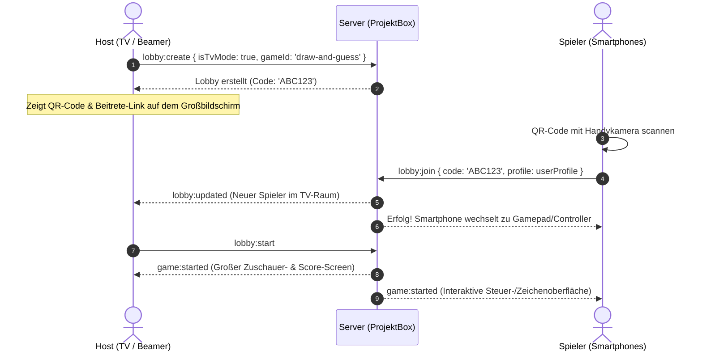

# 🎮 ProjektBox – Modernisierte Web- & Mobile Games Plattform

[](https://react.dev/)
[](https://www.typescriptlang.org/)
[](https://vite.dev/)
[](https://tailwindcss.com/)
[](https://socket.io/)
[](https://web.dev/progressive-web-apps/)

**ProjektBox** ist eine moderne, interaktive Spieleplattform für Web und Mobilgeräte. Sie vereint fesselnde Solo-Games, rundenbasierte 1-gegen-1 Duelle und packende Party-Echtzeitspiele mit nahtlosem TV-/Beamer-Modus und Smartphone-Controllern.

---

## 📋 Inhaltsverzeichnis

- [✨ Highlights & Features](#-highlights--features)
- [🎯 Spielekatalog](#-spielekatalog)
- [⚡ Schnelleinstieg (Quick Start)](#-schnelleinstieg-quick-start)
- [📁 Projektstruktur](#-projektstruktur)
- [📺 TV- / Party-Modus & QR-Code Join](#-tv---party-modus--qr-code-join)
- [🔌 Socket.io Schnittstellen & Events](#-socketio-schnittstellen--events)
- [🌐 REST API Endpunkte](#-rest-api-endpunkte)
- [🛠 Nützliche Befehle (Scripts)](#-nützliche-befehle-scripts)
- [🚀 Neues Spiel hinzufügen](#-neues-spiel-hinzufügen)
- [☁️ Deployment (Render.com & Produktion)](#️-deployment-rendercom--produktion)

---

## ✨ Highlights & Features

- 📱 **Progressive Web App (PWA) & Mobile-First**:
  - Installierbar auf Smartphones, Tablets und Desktop.
  - Vollbild-Modus, Standalone-Display und Offline-Caching (Workbox / Service Worker).
  - Web Audio Synthesizer für Sound-Effekte und Haptisches Feedback (Vibration API).
- 📺 **TV- & Party-Modus (Jackbox-Style)**:
  - Starte eine TV-Lobby auf einem Fernseher, Laptop oder Beamer.
  - Mitspieler scannen einfach den angezeigten QR-Code oder nutzen den 6-stelligen Code bzw. Deep-Link (`?join=CODE`) auf ihrem Smartphone – keine App-Installation notwendig!
  - Der Fernseher dient als zentraler Spielbildschirm, während die Handys als Gamepads und Zeichenflächen fungieren.
- ⚡ **Echtzeit-Synchronisation mit Socket.io**:
  - Millisekunden-Übertragung von Spielzügen, Canvas-Pinselstrichen (Draw & Guess) und Chat-Eingaben.
  - Automatisches Reconnect-Handling mit 45-Sekunden Grace Period bei Verbindungsabbrüchen.
  - Revanche-System (Rematch) direkt nach Spielende.
- 🎨 **Übersichtliches Dashboard & Crystal UI**:
  - Klare visuelle Hierarchie ohne ablenkende Münzanzeigen: Sidebar-Navigation, Echtzeit-Suchleiste, Filter nach Spieltyp und Spielerzahl sowie große, aussagekräftige Spielvorschauen (`GamePreviewArtwork`).
  - Persistente **Favoriten** und **Zuletzt gespielt**-Verlauf für schnellen Wiedereinstieg.
  - Modular anpassbare Spielerprofile mit SVG-Avatar-Generator (Frisuren, Gesichter, Accessoires, Farben).
- 🛡️ **Autoritative Server-Architektur**:
  - Server-validierte Spielzüge gegen Cheating.
  - Schutz vor Event-Flooding durch integriertes Rate-Limiting.
  - Getestete Spiellogik mit automatisierten Node.js Unit-Tests.

---

## 🎯 Spielekatalog

ProjektBox konzentriert sich voll auf **Echtzeit-Multiplayer- & Party-Spiele**:

| Spiel | Kategorie | Spieltyp | Spieler | Dauer | Beschreibung |
| :--- | :--- | :--- | :--- | :--- | :--- |
| **Zeichnen & Raten** | *Party & Kreativ* | Party & Gruppe (TV) | 2–8 | 5–10 Min. | Kreatives Montagsmaler: Einer zeichnet live auf dem Smartphone, alle anderen raten auf Zeit! |
| **Vier gewinnt** | *Strategie* | 1v1 Taktik-Duell | 2 | 3–5 Min. | Taktischer Klassiker: Bringe 4 Steine horizontal, vertikal oder diagonal in eine Reihe. |
| **Tic Tac Toe** | *Strategie* | 1v1 Taktik-Duell | 2 | 1–3 Min. | Schnelles 3×3-Duell mit dynamischer Zugreihenfolge. |

---

## ⚡ Schnelleinstieg (Quick Start)

### 1. Voraussetzungen
- [Node.js](https://nodejs.org/) Version 18 oder neuer.
- npm (wird mit Node.js ausgeliefert).

### 2. Installation
Installiere alle Abhängigkeiten für Root, Client und Server mit einem einzigen Befehl:

```bash
npm run install:all
```

### 3. Entwicklungsmodus starten

```bash
npm run dev
```

Sobald der Prozess läuft:
- 🖥️ **Frontend:** [http://localhost:5173](http://localhost:5173) (automatisch per Proxy mit dem Backend verbunden)
- ⚙️ **Backend:** [http://localhost:5001](http://localhost:5001) (Healthcheck: `/healthz`, REST-Info: `/api/server-info`)

> **💡 Lokaler Party-Test:** Öffne [http://localhost:5173](http://localhost:5173) in zwei verschiedenen Fenstern oder Tabs. Erstelle in einem Tab ein Multiplayer-Spiel und trete mit dem 6-stelligen Code aus dem anderen Tab bei!

---

## 📁 Projektstruktur

```text
ProjektBox-modernisiert/
├── package.json             # Root-Skripte & Concurrently-Konfiguration
├── render.yaml              # Automatisches Deployment-Blueprint für Render.com
├── README.md                # Zentrale Projekt-Dokumentation
│
├── client/                  # Frontend (React 19 + Vite 8 + Tailwind CSS v4 + PWA)
│   ├── public/              # Statische Assets, PWA-Icons & Manifest
│   ├── src/
│   │   ├── components/      # UI-Komponenten (Arcade HUD, Avatar, Crystal UI, Modals)
│   │   │   └── multiplayer/ # Lobby, TV-Host, QR-Scanner, Solo- & Multiplayer-Views
│   │   ├── data/
│   │   │   └── games.ts     # Katalog & Metadaten aller 9 Spiele
│   │   ├── games/
│   │   │   ├── components/  # Spiel-Boards (TicTacToeBoard, DrawAndGuessBoard, etc.)
│   │   │   └── registry.ts  # Client-seitiges Mapping von Spiel-IDs auf Board-Komponenten
│   │   ├── services/
│   │   │   └── socket.ts    # Singleton SocketService für Echtzeit-Kommunikation
│   │   ├── utils/           # Audio-Synthesizer, Haptik, Avatar-State & QR-Code Helfer
│   │   ├── App.tsx          # Hauptkomponente mit Spiele-Karussell & Navigation
│   │   ├── main.tsx         # React Einstiegspunkt mit PWA-Registrierung
│   │   └── index.css        # Tailwind CSS Einbindung & Theme-Variablen
│   ├── vite.config.ts       # Vite-Konfiguration mit PWA-Plugin & Proxy zu Port 5001
│   └── package.json
│
└── server/                  # Backend (Node.js + Express + Socket.io + TypeScript)
    ├── src/
    │   ├── games/
    │   │   ├── definitions/ # Autoritative Spiellogik (Connect Four, Draw & Guess, Tic Tac Toe)
    │   │   └── registry.ts  # Zentrale Registrierung aller Multiplayer-Spiele
    │   ├── lobby/
    │   │   ├── lobbyManager.ts # Raumverwaltung, TV-Modus, Timeout-Grace-Period
    │   │   ├── socketHandlers.ts # Socket.io Events für Lobbys, Spielzüge & Zeichnen
    │   │   └── lobbyAndGames.test.ts # Unit-Tests für Spiellogik & Lobbys
    │   ├── routes/
    │   │   └── api.ts       # Express REST-Endpunkte (/api/health, /api/server-info)
    │   ├── types/
    │   │   └── multiplayer.ts # TypeScript Interfaces für Player, Lobby, GameState
    │   ├── utils/
    │   │   └── rateLimiter.ts # Token-Bucket Rate Limiter gegen Socket-Spam
    │   └── index.ts         # Server-Bootstrapping, statisches Hosting von client/dist
    ├── .env                 # Lokale Umgebungsvariablen (PORT=5001)
    ├── .env.example         # Vorlage für Umgebungsvariablen
    ├── tsconfig.json        # TypeScript-Konfiguration
    └── package.json
```

---

## 📺 TV- / Party-Modus & QR-Code Join

ProjektBox bietet ein nahtloses Party-Spiel-Erlebnis:



1. **TV-Modus aktivieren**: Klicke in der Menüleiste oder Spielansicht auf **"TV-Party"** bzw. erstelle ein Spiel mit aktiviertem TV-Modus.
2. **QR-Code Scan**: Die Mitspieler scannen den QR-Code direkt mit der Smartphone-Kamera und sind sofort in der Lobby.
3. **Synchronisation**: Alle Aktionen auf den Mobilgeräten (z. B. Zeichnen, Raten, Züge setzen) werden in Echtzeit auf dem TV-Bildschirm visualisiert.

---

## 🔌 Socket.io Schnittstellen & Events

Die Kommunikation zwischen Clients und Backend erfolgt über strukturierte Socket.io Events:

### Lobby Lifecycle

| Event | Richtung | Daten / Payload | Beschreibung |
| :--- | :--- | :--- | :--- |
| `lobby:list` | Client ➔ Server | `{ gameId: string }` | Ruft öffentliche Lobbys für ein Spiel ab. |
| `lobby:create` | Client ➔ Server | `{ name, isPrivate, gameId, userProfile, isTvMode }` | Erstellt einen neuen Raum mit 6-stelligem Code. |
| `lobby:join` | Client ➔ Server | `{ lobbyIdOrCode, userProfile }` | Tritt einer bestehenden Lobby bei. |
| `lobby:ready` | Client ➔ Server | *(keine)* | Schaltet den Bereitschaftsstatus des Spielers um. |
| `lobby:start` | Client ➔ Server | *(keine)* | Startet das Spiel (nur Host). |
| `lobby:leave` | Client ➔ Server | *(keine)* | Verlässt die aktuelle Lobby. |
| `lobby:reconnect` | Client ➔ Server | `{ userId: string }` | Stellt die Verbindung bei Verbindungsverlust wieder her. |
| `lobby:updated` | Server ➔ Client | `{ lobby, message? }` | Informiert alle Clients über Änderungen der Lobby. |
| `lobby:player-disconnected` | Server ➔ Client | `{ playerId, playerName, lobby }` | Signalisiert temporären Verbindungsverlust eines Spielers. |

### Gameplay & Interaktion

| Event | Richtung | Daten / Payload | Beschreibung |
| :--- | :--- | :--- | :--- |
| `game:move` | Client ➔ Server | Spielspezifische Zugdaten (z. B. Spalte bei Vier gewinnt) | Führt einen autoritativen Spielzug aus. |
| `game:state` | Server ➔ Client | `{ gameState, status, lobby }` | Sendet den aktualisierten Spielstand an alle Teilnehmer. |
| `game:rematch` | Client ➔ Server | *(keine)* | Stimmt für eine Revanche ab. |
| `game:restarted` | Server ➔ Client | `{ lobby }` | Startet eine neue Spielrunde bei Übereinstimmung. |

### Zeichnen & Raten (Draw & Guess)

| Event | Richtung | Daten / Payload | Beschreibung |
| :--- | :--- | :--- | :--- |
| `draw:strokes` | Client ➔ Server | `{ strokes: Array<Point> }` | Sendet Live-Pinselstriche des Zeichners. |
| `draw:live-strokes` | Server ➔ Client | `{ strokes }` | Broadcastet Pinselstriche an TV und Ratende. |
| `draw:clear` / `draw:live-clear` | Bidirektional | *(keine)* | Leert die Zeichenfläche für alle Teilnehmer. |
| `draw:undo` / `draw:live-undo` | Bidirektional | `{ strokes }` | Nimmt den letzten Pinselstrich zurück. |

---

## 🌐 REST API Endpunkte

Neben den WebSockets stellt der Express-Server folgende HTTP-Endpunkte bereit:

| Methode | Endpunkt | Beschreibung | Beispielantwort |
| :--- | :--- | :--- | :--- |
| `GET` | `/healthz` | Healthcheck für Load Balancer / Cloud-Hostings | `200 OK` |
| `GET` | `/api/health` | Detaillierter Server-Status mit Uptime | `{"status":"ok","uptime":1420,"service":"ProjektBox Server"}` |
| `GET` | `/api/server-info` | Lokale Netzwerk-IPs (für WLAN-Tests) & Render-Status | `{"status":"ok","localIps":["192.168.178.50"],"isRender":false}` |

---

## 🛠 Nützliche Befehle (Scripts)

Im Root-Verzeichnis stehen folgende Befehle zur Verfügung:

| Befehl | Beschreibung |
| :--- | :--- |
| `npm run dev` | Startet Frontend (:5173) und Backend (:5001) parallel mit synchronisierten Logs. |
| `npm run dev:client` | Startet nur den Vite Frontend-Entwicklungsserver. |
| `npm run dev:server` | Startet nur den Express/Socket.io Backend-Server mit `tsx watch`. |
| `npm run build` | Kompiliert Client (`vite build`) und Server (`tsc`) für den Produktionseinsatz. |
| `npm run start` | Führt den kompilierten Produktionsserver aus (`node server/dist/index.js`). |
| `npm run install:all` | Installiert rekursiv alle Abhängigkeiten im Root-, Client- und Server-Verzeichnis. |
| `npm run test --prefix server` | Führt die automatisierten Unit-Tests für Spiellogik, Lobbys und Rate-Limiting aus. |
| `npm run lint --prefix client` | Überprüft das Frontend mit Oxlint. |

---

## 🚀 Neues Spiel hinzufügen

Dank der modularen Architektur lässt sich ProjektBox einfach um neue Spiele erweitern:

1. **Spiellogik im Backend (`server/src/games/definitions/myGame.ts`)**:
   Implementiere das Interface `MultiplayerGameDefinition`:
   - `initGameState(players, starterId, settings)`: Initialer Zustand.
   - `validateAndApplyMove({ state, players, playerId, move })`: Autoritative Validierung und Zugausführung.
2. **Im Backend registrieren (`server/src/games/registry.ts`)**:
   Importiere dein Spiel und registriere es mit `gameRegistry.register(myGameDefinition)`.
3. **Spielkatalog aktualisieren (`client/src/data/games.ts`)**:
   Trage das Spiel mit Titel, Beschreibung, Lucide-Icon und Kategorie ein.
4. **Board-Komponente im Frontend erstellen (`client/src/games/components/MyGameBoard.tsx`)**:
   Erstelle die visuelle Spieloberfläche und registriere sie in `client/src/games/registry.ts`.

---

## ☁️ Deployment (Render.com & Produktion)

ProjektBox ist vollständig für das Hosting auf Cloud-Plattformen wie **Render.com**, **Railway** oder klassischen Virtual Private Servern (VPS) vorbereitet.

### Automatisches Deployment auf Render.com
Im Repository ist eine fertige [render.yaml](file:///c:/Users/Feder/Desktop/ProjektBox-modernisiert/render.yaml) hinterlegt:
1. Erstelle auf [Render](https://render.com) einen neuen **Blueprint**.
2. Wähle dein ProjektBox-Repository aus.
3. Render übernimmt automatisch Build- und Start-Befehle (`npm run build` & `npm start`) und konfiguriert den Healthcheck auf `/healthz`.

### Produktions-Modus
Im Produktionsbetrieb serviert der Express-Server das kompilierte Frontend (`client/dist`) automatisch als Single Page Application (SPA), inklusive Fallback auf `index.html` für clientseitiges Routing. Es wird kein separater Webserver für statische Dateien benötigt.

---

Entwickelt mit ❤️ für gemeinsamen Spielspaß! 🚀
