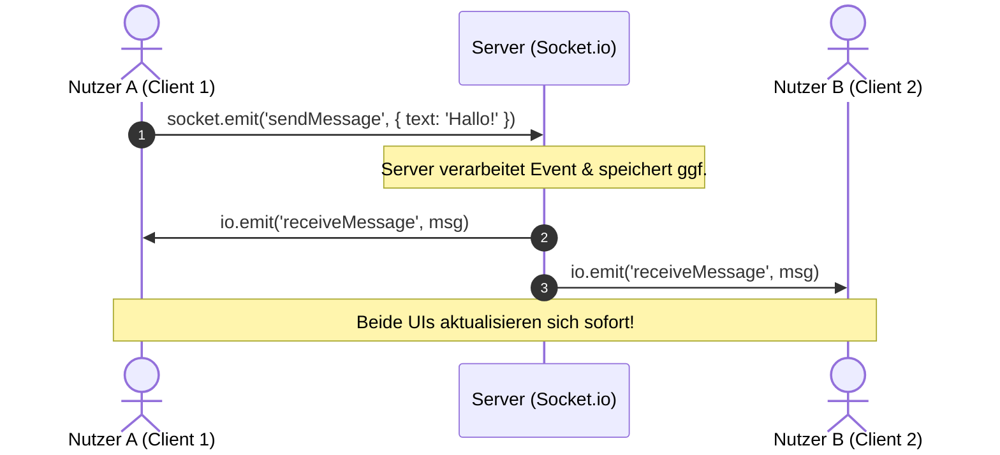

# 🚀 Fullstack Echtzeit-Boilerplate (React & Socket.io)

Ein modernes, sauberes und **einsteigerfreundliches Starter-Template** für Fullstack-Echtzeitanwendungen.

* **Frontend:** [React](https://react.dev/), [Vite](https://vite.dev/), [Tailwind CSS](https://tailwindcss.com/), [Lucide React](https://lucide.dev/)
* **Backend:** [Node.js](https://nodejs.org/), [Express](https://expressjs.com/), [Socket.io](https://socket.io/), [TypeScript](https://www.typescriptlang.org/)

---

## 📋 Inhaltsverzeichnis

- [✨ Highlights](#-highlights)
- [⚡ Schnelleinstieg (Quick Start)](#-schnelleinstieg-quick-start)
- [📁 Projektstruktur](#-projektstruktur)
- [🔌 Wie Socket.io in diesem Projekt funktioniert](#-wie-socketio-in-diesem-projekt-funktioniert)
- [🛠 Nützliche Befehle (Scripts)](#-nützliche-befehle-scripts)
- [💡 Tutorial: Eigenes Socket-Event hinzufügen](#-tutorial-eigenes-socket-event-hinzufügen)
- [🌐 REST API & WebSockets nebeneinander](#-rest-api--websockets-nebeneinander)

---

## ✨ Highlights

- **Ein-Befehl-Start**: Ein einziger Befehl (`npm run dev`) startet Frontend und Backend parallel mit synchronisierten Logs.
- **End-to-End Typsicherheit**: Socket-Events sind auf Client und Server typisiert (`ClientToServerEvents`, `ServerToClientEvents`) – inklusive Autovervollständigung in VS Code.
- **Interaktive Demos out-of-the-box**:
  - 💬 **Echtzeit-Chat**: Nachrichten sofort an alle Clients senden (Broadcast).
  - ⚡ **Gemeinsamer Live-Zähler**: Klicke in Tab 1, sieh das Ergebnis sofort in Tab 2.
  - 📡 **Live-Verbindungsstatus & Latenz**: Ping/Pong-Messung in Millisekunden.
  - 🔌 **REST-API Tester**: Zeigt, wie klassische Express HTTP-Routen parallel zu WebSockets funktionieren.
- **Schöne & responsive Oberfläche**: Gestylt mit modernem Tailwind CSS und Icons von Lucide React.
- **Keine komplizierte Einrichtung**: Sofort einsatzbereit für Anfänger und Fortgeschrittene.

---

## ⚡ Schnelleinstieg (Quick Start)

### 1. Voraussetzungen
Stelle sicher, dass [Node.js](https://nodejs.org/) (Version 18 oder höher) installiert ist.

### 2. Abhängigkeiten installieren
Führe im Hauptverzeichnis des Projekts aus:

```bash
# Installiert Root-, Client- und Server-Pakete automatisch
npm run install:all
```

*(Alternativ kannst du auch einzeln in `client` und `server` jeweils `npm install` ausführen).*

### 3. Entwicklungsmodus starten

```bash
npm run dev
```

Sobald der Befehl ausgeführt wurde:
- 🖥️ **Frontend:** Öffne [http://localhost:5173](http://localhost:5173) im Browser.
- ⚙️ **Backend:** Läuft auf [http://localhost:5000](http://localhost:5000) (Health-Check unter `/api/health`).

> **Tipp zum Ausprobieren:** Öffne die Seite in **zwei separaten Browser-Tabs oder -Fenstern**. Wenn du in einem Tab eine Nachricht schreibst oder den Zähler erhöhst, siehst du die Änderung sofort im anderen Tab!

---

## 📁 Projektstruktur

```text
ProjektBox-modernisiert/
├── package.json             # Root-Konfiguration & parallele Startskripte (concurrently)
├── README.md                # Dokumentation & Schritt-für-Schritt Anleitungen
│
├── client/                  # Frontend (React 19 + Vite + Tailwind + Lucide)
│   ├── src/
│   │   ├── components/      # UI-Komponenten
│   │   │   ├── Header.tsx           # Statusleiste mit Verbindungsindikator & Latenz
│   │   │   ├── ChatDemo.tsx         # Echtzeit-Chat mit Lucide Icons
│   │   │   ├── CounterDemo.tsx      # Global synchronisierter Zähler
│   │   │   ├── ApiDemo.tsx          # Express REST-API Tester
│   │   │   └── TechStackGuide.tsx   # Übersichtskarten & Schnellhilfe
│   │   ├── types/
│   │   │   └── socket.ts    # Clientseitige Typdefinitionen für Socket.io Events
│   │   ├── socket.ts        # Singleton-Socket-Verbindung
│   │   ├── App.tsx          # Hauptkomponente
│   │   ├── main.tsx         # React Einstiegspunkt
│   │   └── index.css        # Tailwind CSS Einbindung
│   ├── vite.config.ts       # Vite-Konfiguration inklusive Backend-Proxy (/api -> :5000)
│   └── package.json
│
└── server/                  # Backend (Node.js + Express + Socket.io + TypeScript)
    ├── src/
    │   ├── routes/
    │   │   └── api.ts       # Express REST-Endpunkte (z. B. /api/health)
    │   ├── socket/
    │   │   └── handlers.ts  # Socket.io Event-Handler (Empfangen & Weiterleiten)
    │   ├── types/
    │   │   └── socket.ts    # Typdefinitionen für Events & Datensätze
    │   └── index.ts         # Server-Einstiegspunkt (Express + HTTP + Socket.io)
    ├── .env                 # Umgebungsvariablen (PORT=5000, CLIENT_ORIGIN)
    ├── tsconfig.json        # TypeScript-Konfiguration
    └── package.json
```

---

## 🔌 Wie Socket.io in diesem Projekt funktioniert

Socket.io ermöglicht eine dauerhafte, bidirektionale Verbindung zwischen Browser und Server:



### Die wichtigsten Befehle auf einen Blick:

| Befehl | Wo? | Bedeutung |
| :--- | :--- | :--- |
| `socket.emit('event', data)` | Client oder Server | Sendet ein Event an die jeweilige Gegenstelle. |
| `socket.on('event', callback)` | Client oder Server | Hört auf ein bestimmtes Event und führt Code aus. |
| `io.emit('event', data)` | Nur Server | **Broadcast an ALLE** aktuell verbundenen Clients. |
| `socket.broadcast.emit(...)` | Nur Server | Sendet an alle Clients **außer dem Absender**. |

---

## 🛠 Nützliche Befehle (Scripts)

Im Hauptverzeichnis stehen folgende Befehle bereit:

| Befehl | Beschreibung |
| :--- | :--- |
| `npm run dev` | Startet Client und Server parallel im Entwicklungsmodus mit Hot-Reloading |
| `npm run dev:client` | Startet nur den Vite Frontend-Entwicklungsserver (Port 5173) |
| `npm run dev:server` | Startet nur das TypeScript Backend mit `tsx watch` (Port 5000) |
| `npm run build` | Baut sowohl Frontend (`vite build`) als auch Backend (`tsc`) für die Produktion |
| `npm run start` | Startet das kompilierte Backend im Produktionsmodus (`node server/dist/index.js`) |
| `npm run install:all` | Installiert alle Pakete im Root-, Client- und Server-Verzeichnis |

---

## 💡 Tutorial: Eigenes Socket-Event hinzufügen

Möchtest du z. B. ein Event `likePost` erstellen? Hier sind die 3 einfachen Schritte:

### 1. Typ definieren (`types/socket.ts`)
Füge das Event in `server/src/types/socket.ts` und `client/src/types/socket.ts` hinzu:

```typescript
export interface ClientToServerEvents {
  likePost: (postId: string) => void;
}

export interface ServerToClientEvents {
  postLiked: (data: { postId: string; likes: number }) => void;
}
```

### 2. Handler im Backend anlegen (`server/src/socket/handlers.ts`)
Reagiere auf das Event und informiere alle Clients:

```typescript
socket.on('likePost', (postId) => {
  const newLikes = 42; // Logik hier
  io.emit('postLiked', { postId, likes: newLikes });
});
```

### 3. Im Frontend auslösen & empfangen (`client/src/...`)

```typescript
// Event senden:
socket.emit('likePost', 'post-123');

// Event empfangen:
useEffect(() => {
  socket.on('postLiked', ({ postId, likes }) => {
    console.log(`Post ${postId} hat nun ${likes} Likes!`);
  });

  return () => {
    socket.off('postLiked');
  };
}, []);
```

---

## 🌐 REST API & WebSockets nebeneinander

Nicht alles muss über WebSockets laufen. Für Login, Registrierung oder statische Datenabfragen ist eine REST-API oft die bessere Wahl.

- **Routen definieren**: In `server/src/routes/api.ts` kannst du beliebige Express-Routen wie `router.post('/login', ...)` oder `router.get('/products', ...)` anlegen.
- **Frontend-Aufruf**: Dank des in `client/vite.config.ts` integrierten Proxies reicht im Frontend ein einfacher Aufruf wie `fetch('/api/health')` – ohne CORS-Probleme im lokalen Modus!

---

## ☁️ Deployment auf Render.com (Web Service)

Wenn du das Projekt auf [Render](https://render.com) veröffentlichst, beachte folgende Einstellungen:

### Option A: Automatisches Deployment mit `render.yaml`
Im Projekt ist eine fertige `render.yaml` hinterlegt. Wenn du das Repository mit Render verknüpfst, wähle **Blueprint** – Render konfiguriert alle Befehle automatisch.

### Option B: Manuelle Konfiguration im Render Dashboard
Wenn du einen neuen **Web Service** anlegst:

| Feld | Wert | Hinweis |
| :--- | :--- | :--- |
| **Root Directory** | *(leer lassen)* | Läuft im Hauptverzeichnis |
| **Environment** | `Node` | Node.js Runtime |
| **Build Command** | `npm run build` | **Wichtig!** Baut Client & Server und erzeugt `server/dist/index.js` |
| **Start Command** | `npm start` | Führt `node server/dist/index.js` aus |

> **Warum der Fehler `Cannot find module '/opt/render/project/src/server/dist/index.js'` auftritt:**  
> Da der Ordner `dist/` in der `.gitignore` liegt, existiert er im Git-Repository nicht. Wenn bei Render als **Build Command** nur `npm install` statt `npm run build` eingetragen ist, wird TypeScript nicht kompiliert und `server/dist/index.js` wird nicht erstellt. Mit `npm run build` wird der Build-Schritt ordnungsgemäß ausgeführt.

---

Viel Erfolg beim Entwickeln deiner Echtzeit-Webanwendung! 🚀
