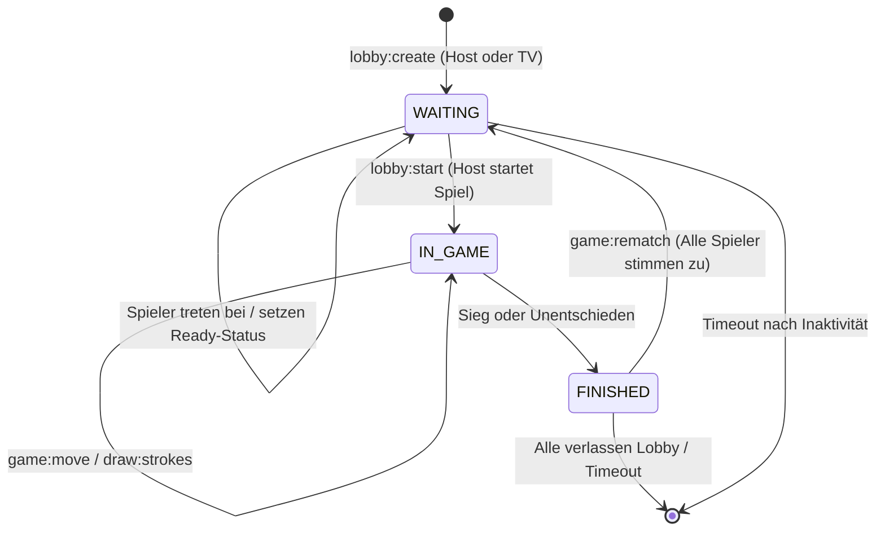

# ⚙️ ProjektBox Server – Echtzeit-Multiplayer Backend

Das Backend von **ProjektBox** ist ein hochperformanter, typisierter Node.js-Server auf Basis von **Express** und **Socket.io**. Es steuert Lobbys, koordiniert den TV-Modus und validiert autoritativ Spielzüge für Multiplayer-Games.

---

## 📋 Inhaltsverzeichnis

- [🛠 Tech-Stack](#-tech-stack)
- [📁 Ordnerstruktur](#-ordnerstruktur)
- [🏢 Lobby-Architektur & Lifecycle](#-lobby-architektur--lifecycle)
- [🎲 Spiele-Registry & Plugin-System](#-spiele-registry--plugin-system)
- [📡 Socket.io Schnittstellen](#-socketio-schnittstellen)
- [🌐 REST API Endpunkte](#-rest-api-endpunkte)
- [🛡️ Sicherheit & Rate-Limiting](#️-sicherheit--rate-limiting)
- [🧪 Unit-Tests](#-unit-tests)
- [⚙️ Umgebungsvariablen](#️-umgebungsvariablen)
- [🚀 Nützliche Befehle](#-nützliche-befehle)

---

## 🛠 Tech-Stack

- **Runtime:** [Node.js](https://nodejs.org/) (ES Modules)
- **Framework:** [Express](https://expressjs.com/)
- **WebSockets:** [Socket.io](https://socket.io/) (v4.8+)
- **Programmiersprache:** [TypeScript](https://www.typescriptlang.org/)
- **Development Tool:** [tsx](https://github.com/privatenumber/tsx) für TypeScript Watch & Execution
- **Testing:** Integrierter Node.js Test Runner (`node:test` via `tsx --test`)

---

## 📁 Ordnerstruktur

```text
server/
├── src/
│   ├── games/
│   │   ├── definitions/     # Implementierung der autoritativen Spiellogik
│   │   │   ├── connectFour.ts   # Vier gewinnt (Schwerkraft, 4-in-einer-Reihe)
│   │   │   ├── drawAndGuess.ts  # Zeichnen & Raten (Wörter, Runden, Punkte, Timer)
│   │   │   └── ticTacToe.ts     # Tic Tac Toe (3×3 Gitter, Sieg- & Remis-Prüfung)
│   │   └── registry.ts      # Zentrale Spiele-Registry mit generischem Interface
│   │
│   ├── lobby/
│   │   ├── lobbyManager.ts      # Raum-Lifecycle, TV-Host, Reconnect-Grace-Period
│   │   ├── socketHandlers.ts    # Socket.io Event-Handler & Room-Broadcasting
│   │   └── lobbyAndGames.test.ts # Automatisierte Tests für Spiellogik & Lobbys
│   │
│   ├── routes/
│   │   └── api.ts           # REST API Routen (/api/health, /api/server-info)
│   │
│   ├── types/
│   │   └── multiplayer.ts   # Schnittstellen für Player, Lobby, GameDefinition
│   │
│   ├── utils/
│   │   └── rateLimiter.ts   # Token-Bucket Rate Limiter zum Schutz vor Socket-Spam
│   │
│   └── index.ts             # Express & Socket.io Server Setup, Statisches PWA Hosting
│
├── .env                     # Lokale Konfiguration (Standard: PORT=5001)
├── .env.example             # Konfigurationsvorlage
├── tsconfig.json            # TypeScript Compiler Optionen
└── package.json
```

---

## 🏢 Lobby-Architektur & Lifecycle

Das Herzstück des Backends ist der Singleton `lobbyManager` (`src/lobby/lobbyManager.ts`):



### Kernfunktionen des Lobby-Managers:
- **Eindeutige Codes**: Generiert benutzerfreundliche, 6-stellige Codes (z. B. `K3X9LP`) ohne leicht verwechselbare Zeichen (wie `0`, `O`, `1`, `I`).
- **TV-Screen Modus**: Räume können mit `isTvMode: true` gestartet werden. Der TV fungiert als Anzeige-Screen, belegt aber keinen Spieler-Slot im Spiel (wird als `isTvScreen` markiert).
- **Grace Period bei Verbindungsverlust**: Trennt ein Spieler die Verbindung (z. B. WLAN-Wechsel oder Browser minimiert), wird er nicht sofort gelöscht. Er bleibt 45 Sekunden lang im Status `connected: false`. Tritt er innerhalb dieses Fensters mit `lobby:reconnect` wieder bei, wird seine Position nahtlos restauriert.
- **Rematch-System**: Nach Spielende können die Teilnehmer für ein Revanche-Spiel abstimmen. Sobald die Mehrheit zustimmt, wird der Spielzustand über die Game-Registry zurückgesetzt.
- **Automatische Müllabfuhr (TTL)**: Inaktive Lobbys werden nach Ablauf von 2 Stunden automatisch aus dem Speicher entfernt.

---

## 🎲 Spiele-Registry & Plugin-System

Multiplayer-Spiele werden über das `MultiplayerGameDefinition`-Interface registriert (`src/types/multiplayer.ts`):

```typescript
export interface MultiplayerGameDefinition<TState = any, TMove = any> {
  id: string;
  title: string;
  minPlayers: number;
  maxPlayers: number;
  initGameState: (players: Player[], starterId?: string, settings?: Record<string, any>) => TState;
  validateAndApplyMove: (params: {
    state: TState;
    players: Player[];
    playerId: string;
    move: TMove;
  }) => { valid: boolean; error?: string; state: TState };
  onPlayerLeave?: (state: TState, leavingPlayerId: string, remainingPlayers: Player[]) => TState;
}
```

### Implementierte Spiele:
1. **Connect Four (`connectFour.ts`)**:
   - 7 Spalten × 6 Reihen.
   - Schwerkraft-Logik (Stein fällt auf die unterste freie Position).
   - Prüft 4 Steine in einer Reihe (horizontal, vertikal und beide Diagonalen).
2. **Draw & Guess (`drawAndGuess.ts`)**:
   - Mehrere Themenkategorien (Tiere, Gegenstände, Berufe, Essen).
   - Runden-Timer und Punktevergabe: Schnellere richtige Schätzungen erhalten mehr Punkte; der Zeichner erhält Bonuspunkte für erfolgreiche Rateversuche.
   - Automatischer Rundenwechsel und Drawer-Rotation.
3. **Tic Tac Toe (`ticTacToe.ts`)**:
   - 3×3 Gitter mit automatischer Erkennung von Siegen und Unentschieden.

---

## 📡 Socket.io Schnittstellen

### Übersicht der Socket-Events:

| Event | Richtung | Payload / Parameter | Beschreibung |
| :--- | :--- | :--- | :--- |
| `lobby:list` | Client ➔ Server | `{ gameId: string }` | Gibt alle öffentlichen Lobbys für das Spiel zurück. |
| `lobby:create` | Client ➔ Server | `{ name, isPrivate, gameId, userProfile, isTvMode }` | Erstellt eine neue Lobby. |
| `lobby:join` | Client ➔ Server | `{ lobbyIdOrCode, userProfile }` | Tritt einer Lobby per ID oder Code bei. |
| `lobby:update-settings` | Client ➔ Server | `{ settings: object }` | Ändert Rundenzeit, Punktelimits etc. (nur Host). |
| `lobby:ready` | Client ➔ Server | *(keine)* | Schaltet Spieler-Bereitschaft um. |
| `lobby:start` | Client ➔ Server | *(keine)* | Startet die Partie (nur Host). |
| `lobby:leave` | Client ➔ Server | *(keine)* | Spieler verlässt die Lobby. |
| `lobby:reconnect` | Client ➔ Server | `{ userId: string }` | Restauriert die Verbindung eines zurückgekehrten Spielers. |
| `game:move` | Client ➔ Server | `moveData: any` | Autoritative Zugausführung (wird servervalidiert). |
| `game:rematch` | Client ➔ Server | *(keine)* | Revanche-Anfrage nach Spielende. |
| `draw:strokes` | Client ➔ Server | `{ strokes: any[] }` | Überträgt Zeichenstriche in Echtzeit. |
| `draw:clear` | Client ➔ Server | *(keine)* | Leert die Zeichenfläche aller Mitspieler. |
| `draw:undo` | Client ➔ Server | *(keine)* | Nimmt den letzten Pinselstrich zurück. |

---

## 🌐 REST API Endpunkte

| Route | Methode | Beschreibung |
| :--- | :--- | :--- |
| `/healthz` | `GET` | Schneller Healthcheck (gibt `200 OK` zurück). Ideal für Render oder Kubernetes. |
| `/api/health` | `GET` | Uptime, Server-Status und Zeitstempel im JSON-Format. |
| `/api/server-info` | `GET` | Liefert Host-Infos, Cloud-Status sowie alle lokalen IPv4-Adressen des Servers (sehr nützlich, um Mobilgeräte im selben WLAN direkt zu verbinden). |

---

## 🛡️ Sicherheit & Rate-Limiting

Um Denial-of-Service (DoS) und Skript-Spam über WebSockets zu verhindern, ist in `src/utils/rateLimiter.ts` ein Token-Bucket / Sliding Window Rate-Limiter aktiv:
- **Maximal 30 Anfragen pro 2-Sekunden-Fenster** pro Socket.
- Bei Überschreitung werden Aktionen mit einer Fehlermeldung abgelehnt (`Zu viele Anfragen. Bitte kurz warten.`).
- Beim Trennen des Sockets wird der Speicher automatisch bereinigt (`cleanupSocketRateLimit`).

---

## 🧪 Unit-Tests

Das Projekt verfügt über automatisierte Unit-Tests für die gesamte Spiellogik und die Lobby-Zustandsübergänge:

```bash
npm run test --prefix server
```

**Getestete Bereiche:**
- **Tic-Tac-Toe**: Erkennung von horizontalen, vertikalen und diagonalen Siegen; Blockierung unbefugter Züge außerhalb der Reihe.
- **Connect Four**: Schwerkraft-Simulation, Erkennung von 4-in-einer-Reihe, Blockierung voller Spalten.
- **Draw & Guess**: Punkteberechnung nach Schnelligkeit, Rundenwechsel, Idempotenz bei Timeouts.
- **Lobby-Manager**: Vollständiger Raum-Lifecycle, TV-Modus-Kennzeichnung, Reconnect-Bereinigung und Ablaufzeiten.
- **Rate-Limiter**: Erlaubt normale Last und drosselt Spam-Bursts.

---

## ⚙️ Umgebungsvariablen

Die Konfiguration erfolgt über Umgebungsvariablen oder eine `.env`-Datei:

```env
# Port des Backends (Standard: 5001)
PORT=5001

# Erlaubte Frontend-Herkunft für CORS (Standard: http://localhost:5173)
CLIENT_ORIGIN=http://localhost:5173

# Optional: Pfade zu SSL-Zertifikaten für lokalen HTTPS-Betrieb
# SSL_KEY_PATH=/pfad/zu/key.pem
# SSL_CERT_PATH=/pfad/zu/cert.pem
```

---

## 🚀 Nützliche Befehle

| Befehl | Beschreibung |
| :--- | :--- |
| `npm run dev` | Startet den Server im Entwicklungsmodus mit Hot-Reloading via `tsx watch`. |
| `npm run build` | Kompiliert TypeScript nach JavaScript in das Verzeichnis `dist/`. |
| `npm run start` | Führt den kompilierten Produktionsserver aus (`node dist/index.js`). |
| `npm run test` | Führt alle Unit-Tests im `src/**/*.test.ts`-Format aus. |
